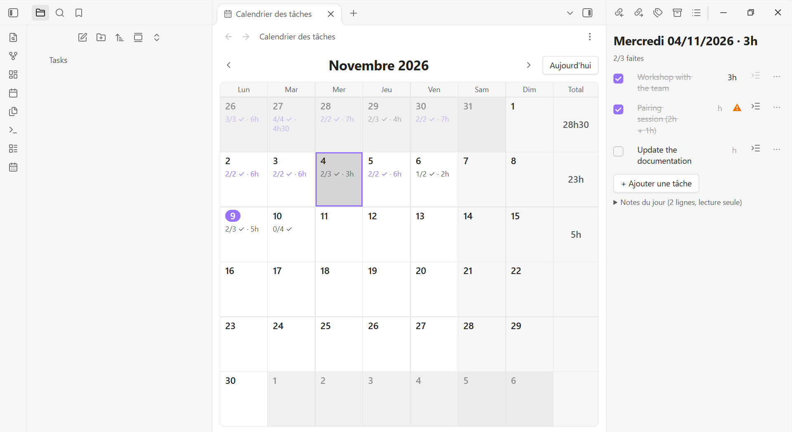
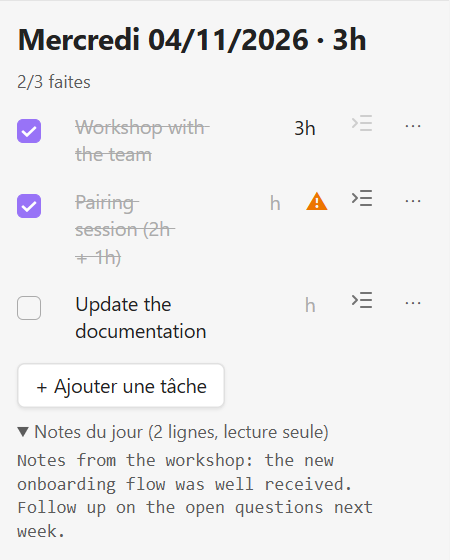
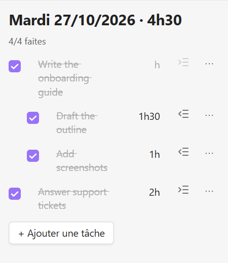
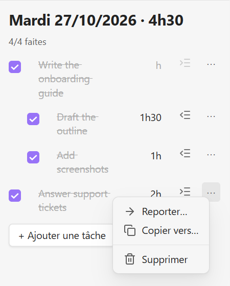
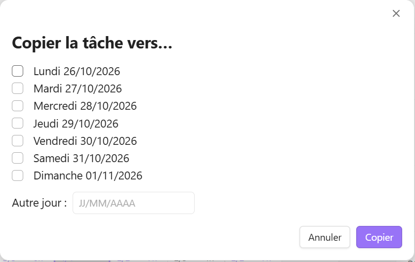
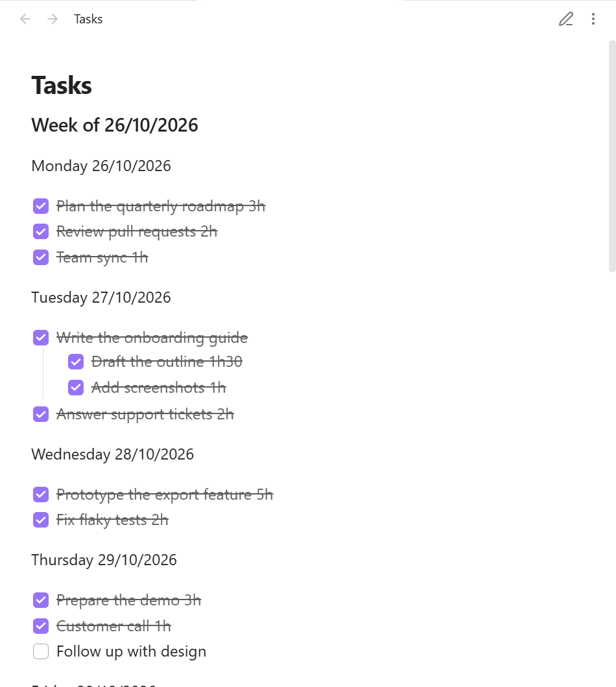

# Weekly Task Calendar

🇬🇧 English · [🇫🇷 Français](README.fr.md)

An [Obsidian](https://obsidian.md) plugin to fill in your weekly to-do list from a big calendar. Click a
day, type your tasks, tick them off and enter the hours when you are done. Everything is written straight
into **one Markdown file**, in a format you can still read and edit by hand:

```markdown
#### Week of 26/10/2026

Monday 26/10/2026
- [x] Unblock two platform services 6h
- [x] Polish the project report 3h

Tuesday 27/10/2026
- [x] Training notebook 2h
- [x] Data corpus 7h
- [ ] Follow up with the team
```

No more copying last week's template and re-typing the headings.

## Features

- **Monthly calendar** with, for each day, `done/total ✓ · hours`, and a **weekly total** column.
- **Day panel** next to the calendar: checkbox, text and hours field for every task. Ticking a task with no
  hours moves the cursor to its hours field, so you quantify as you finish.
- **Sub-tasks**, **move** a task to tomorrow or any day, **copy** a task to several days at once.
- **Two-way**: edit the Markdown file by hand and the calendar follows; use the calendar and the file follows.
- **English and French**: the interface follows Obsidian's language, and the words written in your file
  ("Week of" / "Semaine du", weekday names) can be English or French. Both are always understood when reading.
- **Diagnostic** command listing inconsistencies in the file, without changing anything.

## Screenshots


*The monthly calendar shows, for each day, tasks done / total and hours, plus a weekly total column. The panel on the right is the selected day.*

| Day panel | Sub-tasks |
| --- | --- |
|  |  |
| Tick tasks, edit text and hours; free text of the day stays read-only. ⚠ flags hours the plugin could not read. | Sub-tasks are indented; their hours count in the totals. |

| Task menu | Copy to several days |
| --- | --- |
|  |  |

And the same data as a plain Markdown file, in reading mode:



*Screenshots use fictional data ([`docs/demo/Tasks.md`](docs/demo/Tasks.md)) and Obsidian's French interface; the plugin follows Obsidian's language.*

## Install

Not yet in the community plugin list. To install manually:

1. Download `main.js`, `manifest.json` and `styles.css` from the
   [latest release](https://github.com/Davso20K/obsidian-weekly-task-calendar/releases/latest).
2. Put them in `<your vault>/.obsidian/plugins/weekly-task-calendar/`.
3. In Obsidian: **Settings → Community plugins**, reload the list, enable **Weekly Task Calendar**.

## Usage

1. Click the **calendar** icon in the ribbon, or run the command *Open task calendar*.
2. Click a day: the day panel opens on the right.
3. Add tasks, type hours like `6h`, `2h30`, `1.5` or `45min`, tick them off.
4. **⋯** on a task: *Move…* (tomorrow or another day), *Copy to…* (several days), *Delete*.

By default the plugin reads and writes `Tasks.md` at the root of your vault. Change it in
**Settings → Weekly Task Calendar → Task file**. If the file does not exist, the calendar offers to create it.

## How your data is protected

- Only week headings, day headings and checkbox lines are read and written. Notes, links and paragraphs in
  the same file are kept untouched, in place.
- A task you do not edit is never rewritten. Ticking or unticking only changes the checkbox.
- Every write starts from the latest version of the file (`vault.process`), so a simultaneous manual edit is
  not overwritten. If a line moved between what you saw and your action, the action is cancelled.
- A copy of the task file is saved in the plugin folder (`backup/`) the first time the plugin runs.

## Reading rules

- A **week** is a heading like `#### Week of DD/MM/YYYY` (also `Week …` or `Semaine du …`).
- A **day** is a line containing only a weekday name, with an optional date: `Monday`, `Tuesday 27/10/2026`.
  A line such as `Monday: call back Alex 3h` is a normal note, not a day.
- A day's date comes from its **position** (week start + weekday), not from the date typed on its line, so
  typos in the file do not misplace tasks. If a weekday appears twice in one week, only the first one opens a
  day; the repeat is treated as a note and reported by the diagnostic command.
- **Hours** are recognised only at the end of the line: `6h`, `2h30`, `1h55`, `30min`, `2.5h`, `(3h)`, `: 4h`.
  Ambiguous cases (`2 + 5h`, `8h-10h20`, a lone `4`) and durations over 12 h (usually a meeting time such as
  `17h30`) stay in the text and are left out of the totals; the panel shows ⚠.
- Empty tasks (`- [ ]`) are kept but not counted.

## Settings

| Setting | Description |
| --- | --- |
| Task file | Path of the Markdown file, relative to the vault root. Default `Tasks.md`. |
| Language of headings in the file | `Auto` follows the existing file, then Obsidian's language; or force English / French. |

## Limitations

- Dates are written as `DD/MM/YYYY` and weeks run Monday to Sunday. Other date formats are not supported yet.
- The user interface code (focus handling, modals) is not covered by automated tests; the parser, edit
  operations and view models are.

## Development

```bash
npm install
npm test            # unit tests (Vitest)
npm run typecheck
npm run build       # produces main.js
npm run install-plugin   # copies the build into your vault (set OBSIDIAN_VAULT to change it)
```

The round-trip test reads the author's real task file when present (set `TASK_FILE` to point to another one)
and skips itself otherwise. Releases are built by GitHub Actions: pushing a tag equal to the version in
`manifest.json` publishes `main.js`, `manifest.json` and `styles.css`.

## License

[MIT](LICENSE)
